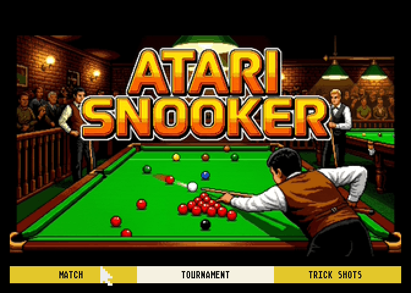

# ATARI SNOOKER VBXE



Snooker for the **Atari XL/XE**: a 3D table that rotates and zooms, full snooker rules,
five computer players, a tournament and trick shots. 6502 assembly, VBXE graphics.

## Hardware

- Atari XL/XE with **VBXE**
- An **ST mouse** in port 2 (title menu), a **joystick** in port 1 (the game)

## Running

Boot `build/snookerVBXE.atr` as **D1:** (Altirra: enable VBXE).

## Controls

| Input | Action |
|-------|--------|
| Joystick left / right | aim |
| Fire (hold, release) | power, shot |
| SPACE + joystick | cue tip: top, screw, side |
| C | camera |
| SHIFT + joystick down | after a foul: the opponent plays again |
| SHIFT + joystick up | after a foul and a miss: balls back, the opponent plays again |
| ESC | menu |

In the title menu choose MATCH, TOURNAMENT or TRICK SHOTS with the mouse;
each player is a human or one of 5 computer players.

## Build

You need [MADS](https://github.com/tebe6502/Mad-Assembler) (`mads.exe` in the project root),
[ZX02](https://github.com/dmsc/zx02) (`zx02.exe` in `docs/mads-src/compression/zx2/pc/`),
Python 3 with `pillow`, and PowerShell.

```
.\tools\build.ps1
```

Output: `build/snookerVBXE.atr`.
